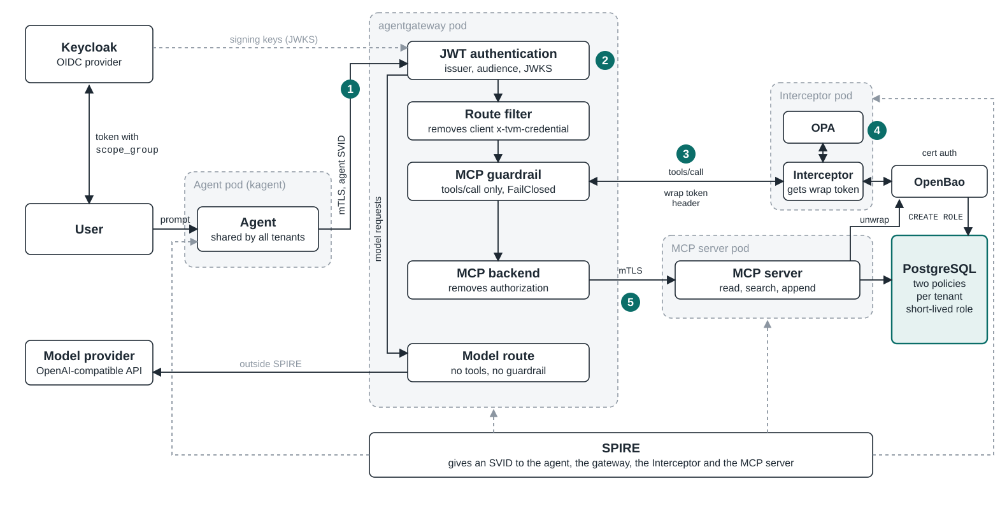
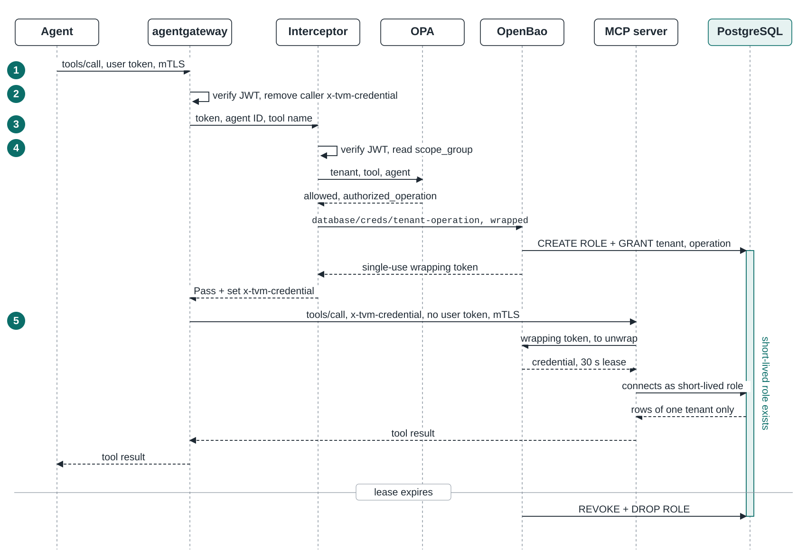

# mcp-tenant-scoped-db-credentials

A reference architecture for one AI agent shared by several tenants, whose data
sits in one PostgreSQL database. It answers one question: when the same agent
serves every tenant, how do you make sure a tool request sees only the rows of
the user who asked, even when the model is manipulated?

The answer is to take the decision away from the agent and the tool code. The
tenant comes only from the user's verified token. For every MCP tool call, a
component outside the agent obtains a PostgreSQL credential valid for 30
seconds, for that tenant and that operation only, and PostgreSQL row-level
security limits the rows the credential can reach. The tool's queries contain
no tenant condition at all.

## Architecture



| Component | Role |
|---|---|
| [kagent](https://kagent.dev/) | runs the shared LangGraph agent |
| [Agentgateway](https://agentgateway.dev/) | the only way out of the agent, to the model and to the MCP server |
| Interceptor | the gateway's MCP guardrail: verifies the token, asks OPA, gets the credential, wrapped |
| [Open Policy Agent](https://www.openpolicyagent.org/) | decides which tools each tenant may use |
| [OpenBao](https://openbao.org/) | creates one PostgreSQL role per tool call, hands it over once, and drops it when the lease expires |
| MCP server | the `read`, `search` and `append` tools |
| [PostgreSQL](https://www.postgresql.org/) | one table for every tenant, row-level security per tenant |
| [Keycloak](https://www.keycloak.org/) | authenticates users; the `scope_group` claim carries the tenant |
| [SPIRE](https://spiffe.io/) | an X.509 identity for every component; every hop is mutual TLS |
| [Ollama](https://ollama.com/) | serves the model, on the host |

A tool call goes through five steps:

1. The agent sends the MCP request to Agentgateway with the user's token.
2. Agentgateway verifies the token against the Keycloak keys, checks that its
   audience is this MCP endpoint, and removes any credential header the client
   sent.
3. For a `tools/call`, Agentgateway asks the Interceptor through the MCP
   guardrail.
4. The Interceptor verifies the token again, reads the tenant from
   `scope_group`, asks OPA whether that tenant may use the tool, and asks
   OpenBao for a credential. OpenBao creates it and answers with a wrapping
   token: a token that can be exchanged for the credential once. The
   Interceptor returns that token in the `x-tvm-credential` header.
5. Agentgateway forwards the request, without the user's token, to the MCP
   server, which exchanges the wrapping token at OpenBao and connects to
   PostgreSQL with the credential.



## Where each control is enforced

| Control | How | File |
|---|---|---|
| Only the agent may use the gateway | the listener requires the agent's SPIFFE ID, whatever token is presented | `agentgateway/gateway.yaml` (`agent-only`) |
| A token issued for another service is refused | the audience must be the MCP endpoint | `agentgateway/gateway.yaml` (`mcp-jwt`) |
| The tenant comes only from the user | the Interceptor verifies the token itself and reads `scope_group`; nothing else is consulted | `interceptor/interceptor/extmcp.py`, `jwt_verify.py`, `claims.py` |
| A user cannot change their own tenant | `scope_group` is declared in the realm's user profile as visible and editable by administrators only | `keycloak/user-profile.json` |
| Another client of the realm cannot issue a tenant | the Interceptor accepts tokens issued to `mcp-client` only (`azp`) | `interceptor/interceptor/jwt_verify.py` |
| A tenant uses only its tools | OPA decides from tenant, tool name and agent identity, never the arguments | `opa/policy.rego` |
| A refused pair does not exist | a (tenant, operation) pair the tenant is not allowed has no credential path, no OpenBao role and no policy line | `interceptor/interceptor/scopes.py`, `openbao/install.sh`, `openbao/interceptor-policy.hcl` |
| The credential is for the operation OPA authorized | the operation comes from `authorized_operation`, not from the tool name; the MCP server refuses to run a tool with a credential issued for another operation | `interceptor/interceptor/extmcp.py`, `mcp-server/mcp_server/__main__.py` |
| No path built from a string | the (tenant, operation) pair is looked up in a fixed table; an unknown pair gets nothing | `interceptor/interceptor/scopes.py` |
| One tenant cannot use up the broker | per tenant, a rate and a number of requests waiting on OpenBao, checked before OpenBao is asked; the agent makes at most 8 tool calls per request | `interceptor/interceptor/limits.py`, `agent/agent/graph.py` |
| The Interceptor can mint and nothing else | its OpenBao policy is `read` on five paths, with wrapping mandatory: no revocation, no renewal, no configuration | `openbao/interceptor-policy.hcl` |
| Only the Interceptor can log in to OpenBao | the `cert` role accepts only the Interceptor's SPIFFE ID | `openbao/install.sh` |
| The credential does not travel | OpenBao returns a single-use wrapping token; the gateway carries that, and the MCP server exchanges it | `interceptor/interceptor/broker.py`, `mcp-server/mcp_server/credential.py` |
| One credential per call, 30 seconds | each role is a member of one tenant role and one operation role | `openbao/install.sh` (`creation_statements`) |
| A forged credential header never reaches the MCP server | the route removes every client copy on every method; the server refuses a `tools/call` without exactly one | `agentgateway/gateway.yaml`, `mcp-server/mcp_server/credential.py` |
| The MCP server never sees the user's token | removed by the gateway and by the Interceptor | `agentgateway/gateway.yaml` (`mcp-backend`), `interceptor/interceptor/extmcp.py` |
| Rows of one tenant only | `ENABLE` + `FORCE ROW LEVEL SECURITY`; one permissive and one restrictive policy per tenant, none for everybody | `postgres/schema.sql` |
| Columns of one operation only | column grants on the operation roles; nobody but the owner can read `scope` | `postgres/schema.sql` |
| Nobody else logs in to the database | `pg_hba.conf` admits the credentials and OpenBao's role to the database `tvm` only, and the superuser only from inside the pod; OpenBao's role has a password only OpenBao knows | `postgres/pg_hba.conf`, `openbao/install.sh` (`rotate-root`) |
| No hint that a document exists elsewhere | another tenant's document and a missing one both return `found: false` | `mcp-server/mcp_server/tools.py` |
| Every hop authenticated | mutual TLS with SPIRE SVIDs, each side accepting one SPIFFE ID | `agent/agent.yaml`, `agentgateway/gateway.yaml`, `interceptor/interceptor.yaml`, `mcp-server/mcp_server/mtls.py` |
| An identity cannot be taken by creating a pod next to its owner | the Interceptor is alone in its namespace; `restricted` Pod Security in every workload namespace; the SPIRE socket comes from the CSI driver, not a host path | `cluster/namespaces.yaml`, `spire/spire-agent.yaml` |
| Fail closed | the guardrail is `FailClosed`; any error in the Interceptor is a denial | `agentgateway/gateway.yaml`, `interceptor/interceptor/extmcp.py` |
| Network paths | `platform`, `interceptor` and `agents` are closed in both directions; each component opens only the connections it needs, so the MCP server reaches PostgreSQL and OpenBao and nothing else | `cluster/network-policies.yaml` |
| Who did what | OpenBao's audit device records every login, credential and exchange; the Interceptor logs tenant, tool, `sub` and request id; the MCP server logs the request id and the database role; PostgreSQL logs the role | `openbao/openbao.yaml`, `interceptor/interceptor/extmcp.py` |
| Schema changes do not open a bypass | a catalog check (tables without `FORCE`, `BYPASSRLS`, `SECURITY DEFINER`, views without `security_invoker`, unique keys without `scope`, any policy other than the two per tenant, an owner with members, a database open to `PUBLIC`) and a probe role per tenant that counts the rows it sees | `postgres/check_rls.sql` |

## Design choices

**The agent's identity carries no tenant.** The agent is shared, so its SPIFFE
ID only proves that a request comes from the agent's workload. The tenant comes
from the user's token, every time.

**Fixed tenant values in the policies, not a session variable.** The common
way to use row-level security in a multi-tenant system is a policy that reads a
session variable, such as `current_setting('app.tenant')`, set by the
application. Here the application runs queries the model chose, so letting it
set the tenant would put the decision back in its code. Instead each policy
names its tenant, and the tenant is fixed by the role the connection logs in
as.

**Two policies per tenant, and none for everybody.** Each tenant role has a
permissive policy and a restrictive policy with the same condition. The
restrictive one is combined with AND, so a permissive policy added later
cannot widen the tenant. There is no `USING (true)` policy that opens the table
to every tenant role: with one, a tenant role whose restrictive policy was
forgotten would see every row; without it, that role sees none.

**Preconfigured roles per tenant and operation.** When OpenBao creates a
database user it can substitute only the name, the password and the expiration
into the SQL, not a tenant. So every allowed (tenant, operation) pair has its
own role definition, and the Interceptor selects the path from a fixed table
rather than building it. A pair a tenant may not use is in none of the three
places, so it is refused even if the OPA policy is wrong.

**The token is verified twice.** The gateway verifies it to admit the request;
the Interceptor verifies it again because it should not mint a credential for a
tenant that only its caller vouches for.

**The credential is wrapped.** The Interceptor does not receive the username
and password, and the gateway does not carry them. OpenBao keeps them and
returns a wrapping token that it will exchange for them once, within 10
seconds; the Interceptor's policy refuses a request that does not ask for
wrapping. The MCP server makes the exchange. So what crosses the gateway, and
whatever records its headers, is a token that is useless after its one use,
and a second exchange fails: the MCP server logs it as an error, because it
means the credential was read by somebody else or the request was replayed.
The cost is one more request to OpenBao per tool call.

**The wrapping token travels in a header, not in `params._meta`.** Up to
Agentgateway v1.5.0 the guardrail did not see the `_meta` the client sent, and
when client and guardrail wrote the same key the client's value reached the MCP
server. From v1.7.0 the guardrail's value wins, but the precedence is a gateway
behaviour that already changed once between versions. A header set by the
guardrail replaces the client's, and the route filter below removes any client
copy on every method.

**A route filter on every method.** The guardrail runs only on `tools/call`, so
a credential header forged on `initialize` would pass through it. The filter on
the route removes every client copy before anything else runs.

**A limit per tenant, before OpenBao.** OpenBao creates and drops roles one at
a time, so every tenant waits in the same queue. The Interceptor gives each
tenant a rate (10 credentials per second, bursts of 20) and a number of
requests that may wait on OpenBao at once (6), and refuses the rest without
asking OpenBao. A tenant whose model calls tools in a loop is refused; the
others are served. The values are environment variables of the Interceptor.

**No connection pool.** PostgreSQL binds the identity to the connection, and a
pool needs one standing identity that can serve every tenant, which is what
this design removes. Each tool call opens its own connection; in an agent, a
model response takes seconds and a connection a few milliseconds.

**Revocation at the end of the lease.** When the lease expires, OpenBao revokes
both memberships and drops the role, so a session still open loses its access
too; `VALID UNTIL` alone would only block new logins. Under load the
revocation can run later than the 30 seconds.

**The Interceptor in its own namespace.** SPIRE gives a pod its identity by
namespace and ServiceAccount, so whoever may create pods in a namespace may
take the identities registered for it. The Interceptor's identity is the one
OpenBao gives credentials to, so it shares its namespace with nothing.

## What it does not protect

- Inside the user's own tenant, a manipulated model can still use every
  operation that tenant is allowed, for example append text to a document or
  reveal data of the same tenant in its answer. The architecture protects the
  boundary between tenants.
- A user belongs to one tenant. A `scope_group` with several values is
  refused, and a database role that is a member of two tenant roles sees no
  rows, because the restrictive policies are combined with AND. Serving a
  user of several tenants is more than a change to the policies: one
  conversation would then hold rows of two tenants, and the model could carry
  them from one to the other.
- A copied credential can be used until its lease expires: at most 30 seconds,
  for the rows of one tenant and one operation. The place it can be copied
  from is the MCP server, which uses it.
- Three components are trusted with more than one tenant. The Interceptor can
  ask for a credential of any tenant; it has a dedicated identity and
  namespace, a fixed table of paths, and no permission to revoke or renew. The
  MCP server receives, one call at a time, the credential of every tenant; it
  holds none between calls and can open connections only to PostgreSQL and
  OpenBao. The gateway carries the users' tokens, each valid for five minutes.
- `bao_admin`, the database role OpenBao creates credentials with, can create
  a role in any tenant. Its password is known only to OpenBao, but
  `pg_hba.conf` cannot tell OpenBao's pod from another one that reaches
  PostgreSQL; a client certificate for that role would.
- Throughput is limited by OpenBao, which creates and drops roles one at a time
  under one lock per database connection configuration. The limit per tenant
  is kept in each Interceptor replica.
- Timing and other side channels are not addressed.

## Run it

Requirements: Docker Desktop (the pods reach Ollama at its host address,
`192.168.65.254`; with another runtime, change it in `agentgateway/gateway.yaml`),
about 8 GB of memory for Docker, `kind`, `kubectl`, `jq`, `openssl`, `curl`,
`python3`, `shasum`, and Ollama on the host with `ollama pull qwen2.5:7b`.

```bash
bash install.sh     # creates the cluster and installs everything
bash demo.sh        # three requests to the agent
bash uninstall.sh   # deletes the cluster
```

| User | Request | Result |
|---|---|---|
| alice (`tenant1`) | read `t1-001` | the document |
| alice (`tenant1`) | read `t2-001` | `found: false`: the document belongs to `tenant2` |
| bob (`tenant2`) | append to `t2-001` | refused by OPA: `tenant2` may not use `append` |

Generated passwords and keys are kept in Kubernetes Secrets and in `.tmp/`;
nothing secret is in the repository.

### Adding a tenant

A tenant is a reviewed change to `tenants/tenants.json`, `postgres/schema.sql`
(its role and its two policies), `openbao/install.sh`,
`openbao/interceptor-policy.hcl`, `opa/policy.rego` and
`interceptor/interceptor/scopes.py`. A new operation is also a change to
`postgres/pg_hba.conf` and to the MCP server's tools. Then run:

```bash
python3 tenants/check_tenants.py   # every file agrees with the registry
bash postgres/check_rls.sh         # no configuration bypasses row-level security
```

Every component script can be run again after a change to its files: it
applies the change and restarts what reads it.

### Not built here

This runs on a local cluster: one replica per component, no backups, Keycloak
in development mode (it creates new signing keys at every start, and the
gateway takes up to five minutes to fetch them), OpenBao unsealed with one key
kept in a Secret, and certificates that are not rotated (ten years for the
servers, one year for the SPIRE CA, whose bundle is copied to OpenBao once at
install time).
